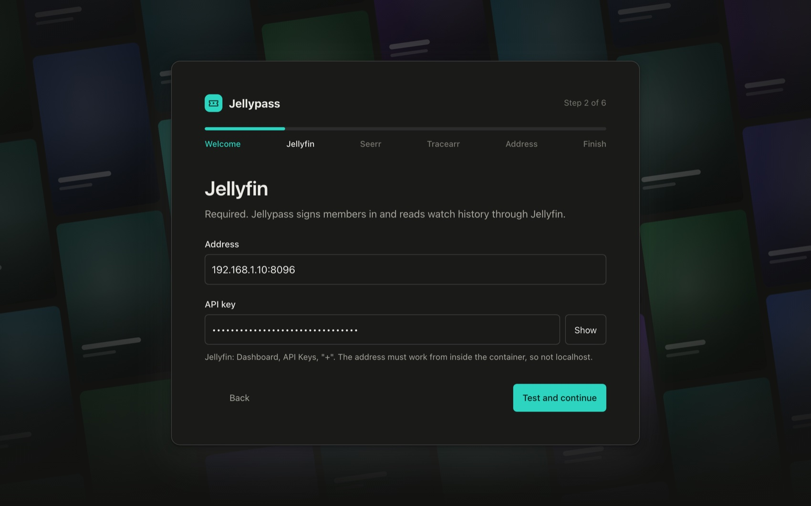
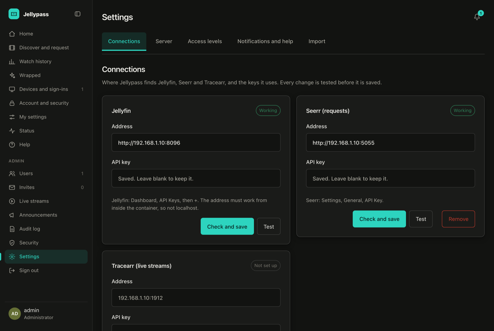

<p align="center"></p>

# Jellypass

A members' portal for a private [Jellyfin](https://jellyfin.org) library, for the person who runs a server for family and friends. People get an invite link, set up their own account and devices, request titles through [Seerr](https://docs.seerr.dev), and see their own history. You get admin tools to manage who has access and for how long.

Jellypass reads everything about what people watch live from Jellyfin and Seerr. Its own database only holds what they cannot: invites, access levels and end dates, preferences, notices and the audit log.

## What it does

**For members**
- Invite links and a guided first sign-in, including phone and TV app set-up guides
- Home, Discover and request (through Seerr), Watch history, a yearly Wrapped and an optional Compare with other members
- Devices and sign-ins, with alerts for new sign-ins, plus two-step sign-in (authenticator app or passkey)
- Optional notices by browser push, an in-app bell, or email

**For admins**
- Users with access levels, end dates, expiry and account disable, and bulk invites with a live email preview
- Live streams (with an optional map), an audit log, a security overview and announcements
- Maintenance mode, an outage status page, and a daily digest

**Self-hosted**
- One Docker container (SQLite in a volume), Portainer-friendly compose file
- First-run setup wizard, then everything is editable in Settings: connections, public address, HTTPS (self-signed or your own certificate), Cloudflare Turnstile and SMTP
- Works behind a reverse proxy or a Cloudflare Tunnel; email is optional
- Version, changelog and an update notice

## Screenshots

The first-run wizard connects Jellyfin, Seerr and Tracearr and tests each one before moving on.



Settings, Connections: change a service's address or key at any time. Every change is tested before it is saved.



Settings, Server: the version and what changed, the public address, built-in HTTPS and proxy trust, the sign-in challenge and email. Changes apply without a restart.


The screenshots use a demo server and example addresses.

## Quick start

```sh
curl -O https://raw.githubusercontent.com/Ol775/Jellypass/main/docker-compose.yml
docker compose up -d
```

Then open `http://<your-server>:8787` and follow the setup wizard. You need a Jellyfin administrator API key (Jellyfin: Dashboard, API Keys). In Portainer, paste the compose file into a new stack instead. The full guide, including HTTPS, tunnels and updates, is in [docs/SELF-HOSTING.md](docs/SELF-HOSTING.md).

## Status

Jellypass has run a family Jellyfin library daily since 2026. The self-hosted version is new in 1.0.0, so expect rough edges; issues and pull requests are welcome. See the [changelog](CHANGELOG.md).

## Development

```sh
npm ci
npm test            # about 600 tests, run in a Workers-compatible test pool
npm run typecheck
```

The app is Hono on Node, written to run as a Cloudflare Worker and wrapped for Docker by `selfhost/server.ts`; see "How it works" in the self-hosting guide.

## Licence

[MIT](LICENSE). Third-party components are listed in [NOTICE.md](NOTICE.md).
