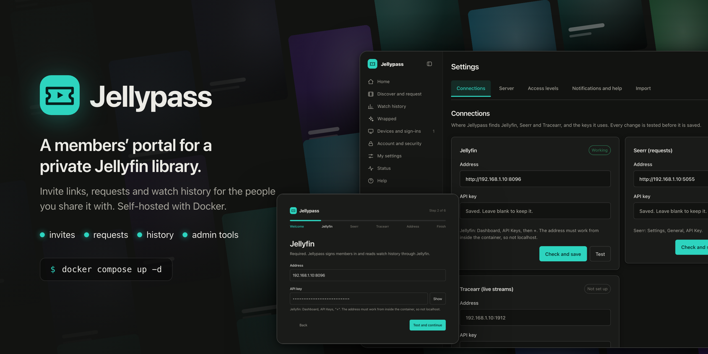
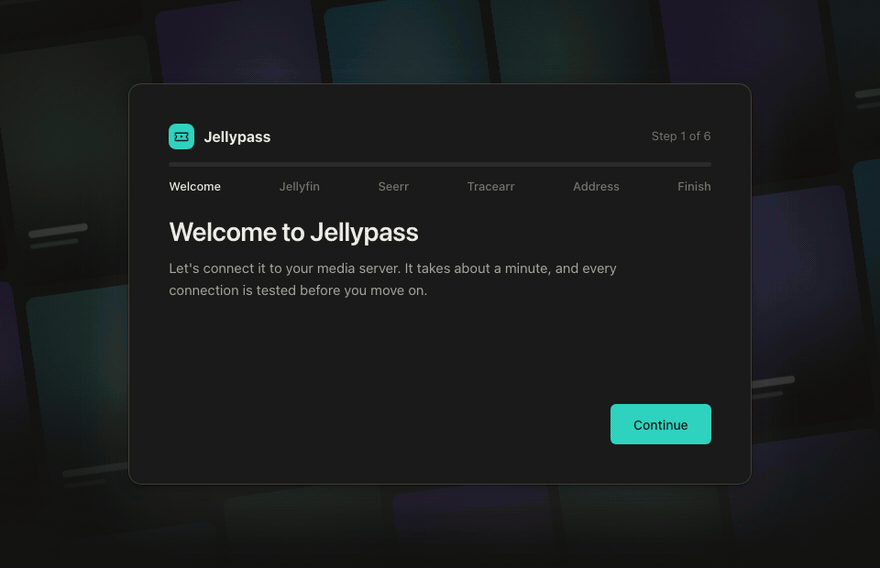
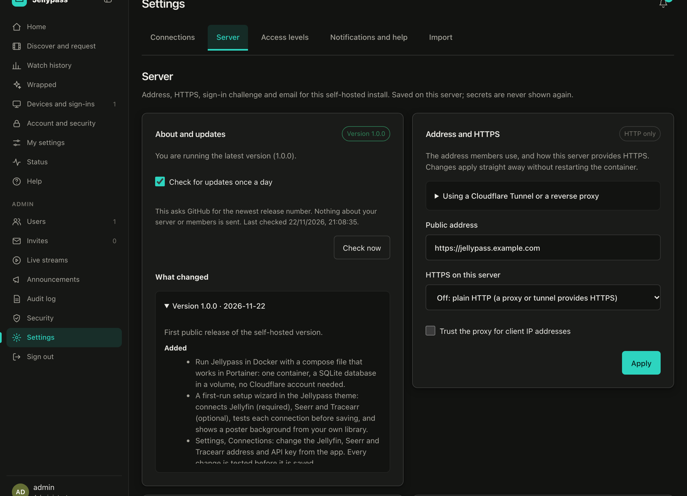
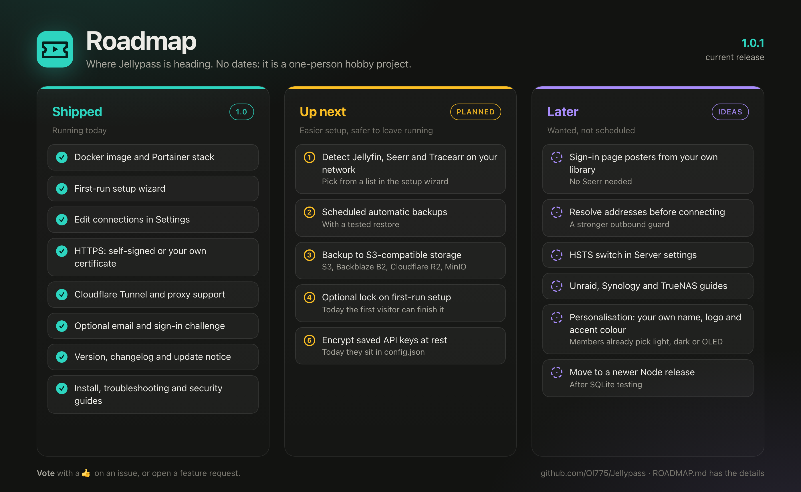

<p align="center"></p>

# Jellypass

A members' portal for a private [Jellyfin](https://jellyfin.org) library, for the person who runs a server for family and friends. People get an invite link, set up their own account and devices, request titles through [Seerr](https://docs.seerr.dev), and see their own history. You get admin tools to manage who has access and for how long.

Jellypass reads everything about what people watch live from Jellyfin and Seerr. Its own database only holds what they cannot: invites, access levels and end dates, preferences, notices and the audit log.

## What it does

**For members**
- Invite links and a guided first sign-in, including phone and TV app set-up guides
- Home, Discover and request (through Seerr), Watch history, a yearly Wrapped and an optional Compare with other members
- Devices and sign-ins, with alerts for new sign-ins, plus two-step sign-in (authenticator app or passkey)
- Optional notices by browser push, an in-app bell, or email

**For admins**
- Users with access levels, end dates, expiry and account disable, and bulk invites with a live email preview
- Live streams (with an optional map), an audit log, a security overview and announcements
- Maintenance mode, an outage status page, and a daily digest

**Self-hosted**
- One Docker container (SQLite in a volume), Portainer-friendly compose file
- First-run setup wizard, then everything is editable in Settings: connections, public address, HTTPS (self-signed or your own certificate), Cloudflare Turnstile and SMTP
- Works behind a reverse proxy or a Cloudflare Tunnel; email is optional
- Version, changelog and an update notice

## Screenshots

The first-run wizard connects Jellyfin, Seerr and Tracearr and tests each one before moving on. When Jellyfin connects, the background fills with posters from your library.



Settings, Connections: change a service's address or key at any time. Every change is tested before it is saved.


Settings, Server: the version and what changed, the public address, built-in HTTPS and proxy trust, the sign-in challenge and email. Changes apply without a restart.



The screenshots use a demo server and example addresses.

## Install

You need a Jellyfin administrator API key (Jellyfin: Dashboard, API Keys). Nothing else is required up front: the setup wizard asks for the rest the first time you open the site.

### Portainer (as a stack)

1. In Portainer choose **Stacks**, then **Add stack**, and name it `jellypass`.
2. Pick **Web editor** and paste the compose file below. (Or pick **Repository** instead, use `https://github.com/Ol775/Jellypass` with the compose path `docker-compose.yml`, and Portainer fetches it for you.)
3. Press **Deploy the stack**.
4. Open `http://<your-server>:8787` and follow the setup wizard.

```yaml
# Jellypass, self-hosted. Paste into a Portainer stack (Stacks > Add stack > Web editor)
# No variables are needed: open the site on first run and a setup page asks for Jellyfin, Seerr and Tracearr.
# Variables are only starting values: anything saved in the app (Settings, Server) wins.
services:
  jellypass:
    image: ${JELLYPASS_IMAGE:-ghcr.io/ol775/jelly-pass:latest}
    # To build from a checkout instead of pulling: uncomment, and run `docker compose up -d --build`.
    # build: .
    container_name: jellypass
    restart: unless-stopped
    ports:
      - "${BIND_ADDR:-0.0.0.0}:${PORT:-8787}:8787"   # set BIND_ADDR=127.0.0.1 if the proxy runs on this host; put a TLS reverse proxy (Caddy, Nginx Proxy Manager, Traefik) in front of this
    volumes:
      - jellypass-data:/data   # SQLite database; map tiles and GeoIP files go in /data/tiles
    environment:
      PUBLIC_URL: ${PUBLIC_URL:-}
      JELLYFIN_URL: ${JELLYFIN_URL:-}
      JELLYFIN_ADMIN_KEY: ${JELLYFIN_ADMIN_KEY:-}
      SESSION_SECRET: ${SESSION_SECRET:-}
      TLS_MODE: ${TLS_MODE:-}        # empty = plain http (behind a proxy/tunnel); self-signed = built-in https; custom = your cert in /data/tls
      TLS_HOSTS: ${TLS_HOSTS:-}      # extra names/IPs for the self-signed certificate, e.g. 192.168.1.10,jellypass.lan
      TRUST_PROXY: ${TRUST_PROXY:-false}
      TURNSTILE_SITEKEY: ${TURNSTILE_SITEKEY:-}
      TURNSTILE_SECRET: ${TURNSTILE_SECRET:-}
      SEERR_URL: ${SEERR_URL:-}
      SEERR_API_KEY: ${SEERR_API_KEY:-}
      TRACEARR_URL: ${TRACEARR_URL:-}
      TRACEARR_TOKEN: ${TRACEARR_TOKEN:-}
      KEYS_SECRET: ${KEYS_SECRET:-}
      VAPID_KEYS: ${VAPID_KEYS:-}
      MAIL_FROM: ${MAIL_FROM:-jellypass@localhost}
      SMTP_HOST: ${SMTP_HOST:-}
      SMTP_PORT: ${SMTP_PORT:-587}
      SMTP_SECURE: ${SMTP_SECURE:-false}
      SMTP_USER: ${SMTP_USER:-}
      SMTP_PASS: ${SMTP_PASS:-}

  # Optional Cloudflare Tunnel. Turn it on with COMPOSE_PROFILES=tunnel and a TUNNEL_TOKEN from Cloudflare Zero Trust
  # (Networks, Tunnels). Point the tunnel's public hostname at http://jellypass:8787, set PUBLIC_URL to that https
  # address and TRUST_PROXY=true. With a tunnel you can remove the ports: section above so nothing is exposed on the LAN.
  cloudflared:
    image: cloudflare/cloudflared:latest
    profiles: ["tunnel"]
    restart: unless-stopped
    command: tunnel --no-autoupdate run
    environment:
      TUNNEL_TOKEN: ${TUNNEL_TOKEN:-}
    depends_on: [jellypass]

volumes:
  jellypass-data:
```

To update later, open the stack and choose **Pull and redeploy**. Your data stays in the `jellypass-data` volume.

### Docker Compose

Save the YAML above as `docker-compose.yml` in a new folder (or download it with `curl -O https://raw.githubusercontent.com/Ol775/Jellypass/main/docker-compose.yml`), then run:

```sh
docker compose up -d
```

Open `http://<your-server>:8787`. To update: `docker compose pull && docker compose up -d`.

### Plain Docker

No compose needed:

```sh
docker run -d --name jellypass --restart unless-stopped \
  -p 8787:8787 -v jellypass-data:/data \
  ghcr.io/ol775/jelly-pass:latest
```

The full walkthrough (getting the Jellyfin key, the setup wizard step by step, your first invite, updating, backup and restore) is in the **[install guide](docs/INSTALL.md)**. If something does not work, see **[troubleshooting](docs/TROUBLESHOOTING.md)**. HTTPS, a Cloudflare Tunnel, email and everything else you can change afterwards is in [docs/SELF-HOSTING.md](docs/SELF-HOSTING.md).

## Documentation

- [Install guide](docs/INSTALL.md): from nothing to your first invited member
- [Troubleshooting](docs/TROUBLESHOOTING.md): symptoms, causes and fixes, with the exact error messages
- [Self-hosting reference](docs/SELF-HOSTING.md): HTTPS options, Cloudflare Tunnel, email, every environment variable
- [Roadmap](ROADMAP.md): what is shipped, what is next, and what is not planned
- [Security policy](SECURITY.md): how to report a vulnerability, how Jellypass protects you, and known limitations
- [Contributing](CONTRIBUTING.md) and the [Code of Conduct](CODE_OF_CONDUCT.md)
- [Changelog](CHANGELOG.md)

## Roadmap

[](ROADMAP.md)

**Up next:**

- Detect Jellyfin, Seerr and Tracearr on your network
- Scheduled automatic backups
- Backup to S3-compatible storage
- Optional lock on first-run setup
- Encrypt saved API keys at rest

See the [full roadmap](ROADMAP.md) for what has shipped, the reasons behind each item and the wish list. Vote with a 👍 on an issue, or open a [feature request](https://github.com/Ol775/Jellypass/issues/new?template=feature_request.yml).

## Status

Jellypass has run a family Jellyfin library daily since 2026. The self-hosted version is new in 1.0.0, so expect rough edges; issues and pull requests are welcome. See the [changelog](CHANGELOG.md).

## Development

```sh
npm ci
npm test            # about 600 tests, run in a Workers-compatible test pool
npm run typecheck
```

The app is Hono on Node, written to run as a Cloudflare Worker and wrapped for Docker by `selfhost/server.ts`; see "How it works" in the self-hosting guide.

## Licence

[MIT](LICENSE). Third-party components are listed in [NOTICE.md](NOTICE.md).
